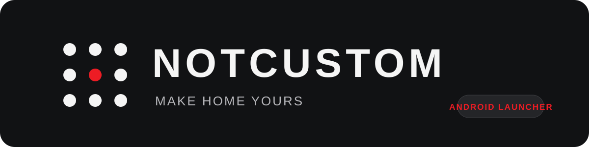

<p align="center">
  
</p>

<p align="center">ANDROID 12+ &nbsp;•&nbsp; NO ROOT &nbsp;•&nbsp; MIT LICENSE</p>

NotCustom is an Android launcher with a flexible Home screen, app drawer, widgets, and optional Shizuku-powered system tweaks. It takes visual inspiration from Nothing OS while keeping Nothing Launcher intact.

> Not affiliated with Nothing Technology Limited. NotCustom does not require root and does not add Glyph features.

## Install

### Download the APK

Get the latest beta from [GitHub Releases](https://github.com/ddddaaaattttoooo/notcustom/releases). GitLab users can use the [GitLab Releases page](https://gitlab.com/ddddaaaattttoooo/notcustom/-/releases); its APK link points to the same published file.

### Install on your phone

1. Open the release page on your Android phone and download `NotCustom-…-release.apk`.
2. Open the downloaded file. If Android asks, allow your browser or Files app to install unknown apps, then confirm **Install**.
3. Press Home and choose **NotCustom Home**. Choose **Always** if you want it as your default launcher. You can change this later in Android's Default apps settings.
4. Optional: open Home Settings to enable accessibility access for screen-off and notification-shade gestures. Android may require **App info → Allow restricted settings** for a sideloaded build.

To update, install the newer APK over the existing app. Beta APKs use Android's debug signing key, so Android may reject an update if the two APKs were signed with different keys. Uninstalling first removes NotCustom's saved layout and settings. A stable release-signing key is needed before promising seamless updates between every release.

## Compatibility

- **Android 12 or newer** is required. NotCustom Home uses standard Android launcher APIs and is intended to work on Android phones from different manufacturers, including Nothing, Pixel, and Samsung devices.
- **Verified device:** Nothing Phone 3a Lite running Nothing OS 4.x. Other brands and Android versions have not all been tested; drawer behavior, widgets, gestures, and launcher selection can vary by manufacturer.
- **System tweaks are device-dependent.** The optional FEEL/DISPLAY tweaks require Shizuku and may not be supported on every Android build. The launcher works without Shizuku.

## Features

### Home screen

- Multiple pages with drag-and-drop app placement
- A compact dock fixed at the bottom, editable by dragging apps between the dock and Home
- Drawer in GRID, LIST, or SMART mode
- App labels, icon size, columns, icon packs, and monochrome icons
- Clock with 12/24-hour format, battery status, or next alarm in the header
- Android app widgets, plus a searchable widget picker
- Swipe up for the drawer; optional gestures for notifications and screen-off

### Optional system tools

- FEEL and DISPLAY presets, density and font-scale controls, and a Quick Settings tile
- Shizuku support for protected settings; no root required

## Permissions and privacy

- NotCustom does not request Internet access. Battery and next-alarm header options read on-device information.
- Accessibility access is optional and used only for requested global actions such as opening notifications or locking the screen. It does not read screen content.
- Shizuku is optional and used only for system-level tweaks.
- Launcher preferences, app placements, and widget IDs are stored locally.

## Build from source

Requirements: JDK 17 and Android SDK Platform 34.

```bash
git clone https://github.com/ddddaaaattttoooo/notcustom.git
cd notcustom
./gradlew assembleDebug
```

The APK is created under `app/build/outputs/apk/debug/`. Release builds are signed with the Android debug key for local testing; configure your own signing key before distributing a production build.

## Help and contributions

Found a bug? Open an issue on [GitHub](https://github.com/ddddaaaattttoooo/notcustom/issues) or [GitLab](https://gitlab.com/ddddaaaattttoooo/notcustom/-/issues). Please include your phone model, Android version, NotCustom version, and steps to reproduce. Don't include private logs or personal data.

Merge requests and pull requests are welcome. See [CONTRIBUTING.md](CONTRIBUTING.md) for the build and review workflow.

## License

NotCustom is released under the [MIT License](LICENSE).
