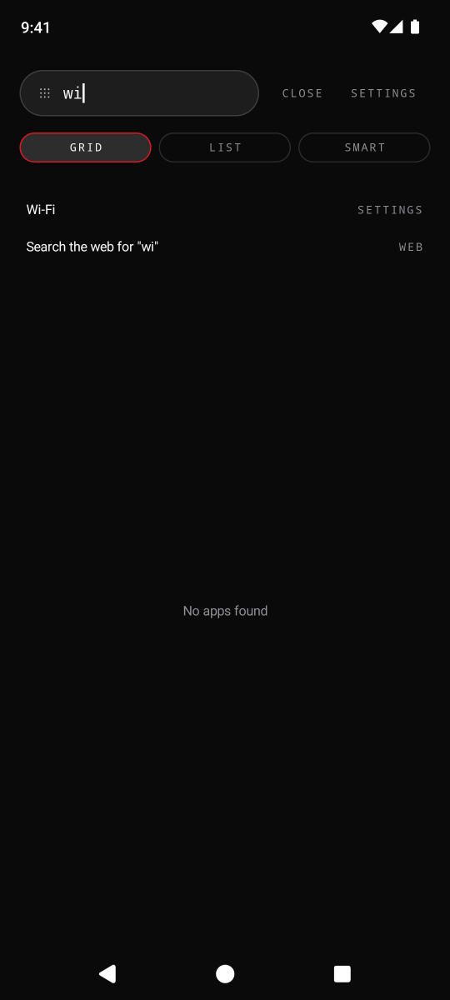
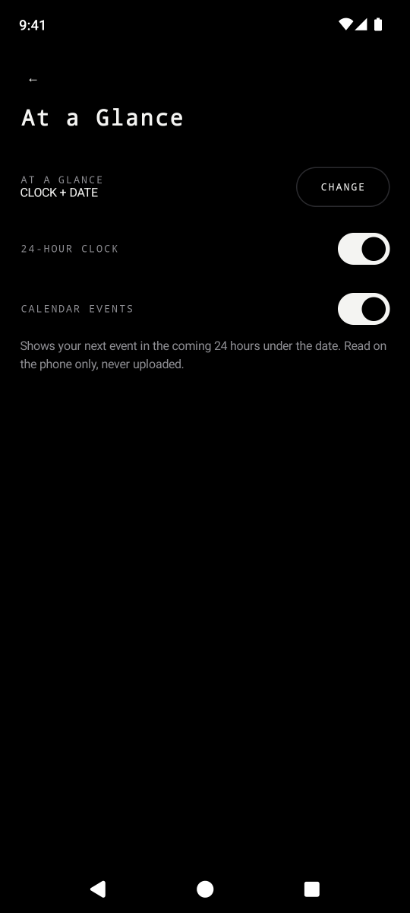
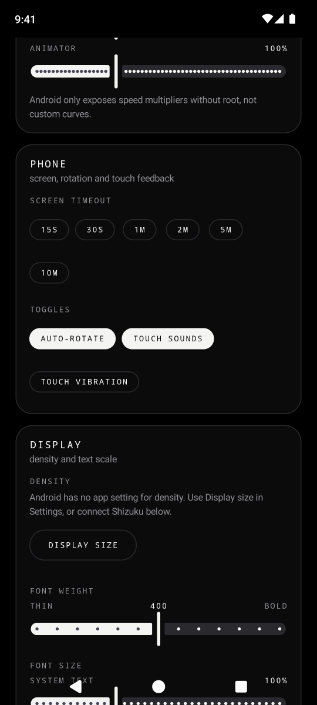
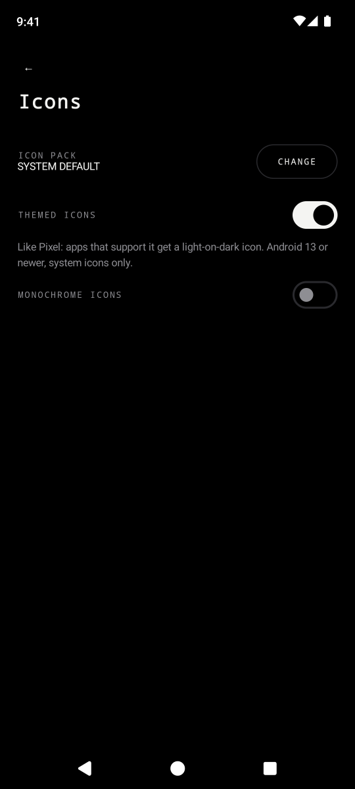
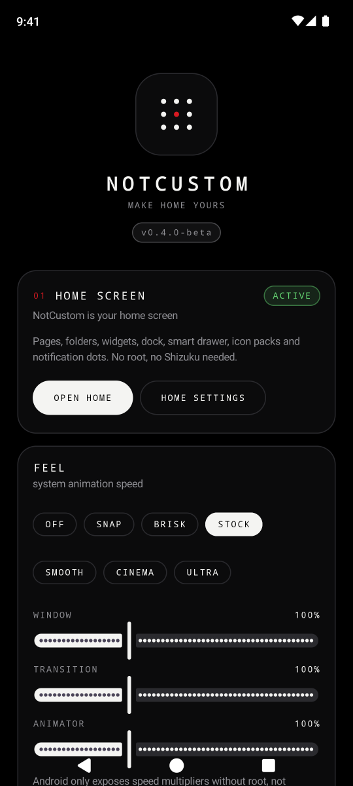
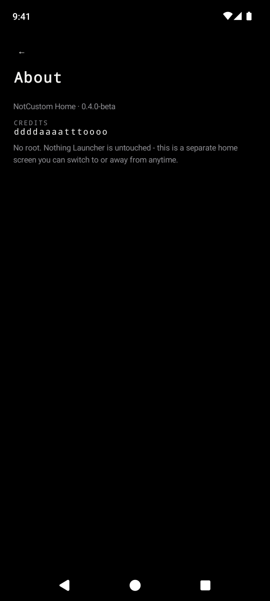

<p align="center">
  
</p>

<p align="center">
  <a href="https://github.com/ddddaaaattttoooo/notcustom/releases/tag/v0.4.1-beta"></a>
  <br />
  <a href="https://ko-fi.com/ddddaaaattttoooo"></a>
  <a href="https://discord.gg/gr4uwUyYTG"></a>
</p>

<p align="center">
  
  
  
  
</p>

NotCustom is a black-and-white Android home screen inspired by Nothing OS.
Pages, folders, widgets, a smart app drawer, and system tweaks that work
without root. Your phone's own launcher stays untouched, so you can switch
back any time.

<p align="center">
  
  
  
</p>
<p align="center">
  
  
  
</p>
<p align="center">
  
  
  
</p>
<p align="center">
  
  
  
</p>

> Not affiliated with Nothing Technology Limited.

## What it does

- **Home:** pages, folders, a five-slot dock, and widgets you can resize.
- **At a Glance:** a big clock with the date, your next calendar event, battery or next alarm.
- **App drawer:** GRID, LIST or SMART, which sorts apps into categories like Nothing OS.
- **Search:** apps, Android settings pages, quick maths (`12*3`) and web search.
- **Icons:** icon packs, Pixel-style themed icons, or plain monochrome.
- **Feels right:** haptics when you pick up and drop, notification dots, app shortcuts.
- **Backup:** save your layout to a file and restore it on a new phone.
- **System tweaks:** animation speed, font size and weight, screen timeout, auto-rotate and more.

## Install

1. Download `NotCustom-0.4.1-beta-release.apk` from the [release page](https://github.com/ddddaaaattttoooo/notcustom/releases/tag/v0.4.1-beta) on your phone.
2. Open it and allow the install.
3. Press **Home**, choose **NotCustom Home**, tap **Always**.

Updating: install the new APK over the old one, or tap **CHECK** at the top of Settings. Your layout stays.

## System tweaks

No root needed, and Shizuku is optional.

| Tweak | What it needs |
|---|---|
| Font size, screen timeout, auto-rotate, touch sounds and vibration | One **ALLOW** switch on the phone |
| Animation speed, font weight | One command from a computer, or Shizuku once |
| Density | Shizuku. Otherwise NotCustom opens Android's Display size |

The command, run once over USB debugging:

```bash
adb shell pm grant dev.notcustom.app android.permission.WRITE_SECURE_SETTINGS
```

NotCustom never changes your display size unless you tap a density option yourself.

## Permissions

| Permission | Why |
|---|---|
| Internet | checking for and downloading NotCustom updates, nothing else |
| Notification access (optional) | counting notifications for the dots, never reading them |
| Accessibility (optional) | double-tap to lock and pulling down notifications |
| Calendar (optional) | your next event on Home, read on the phone only |
| Modify system settings (optional) | the tweaks in the table above |

No analytics, no tracking, no account. Your layout stays on the phone.

## Build

```bash
git clone https://github.com/ddddaaaattttoooo/notcustom.git
cd notcustom
./gradlew assembleDebug
```

Needs JDK 17 and Android SDK 34. Found a bug? Open an [issue](https://github.com/ddddaaaattttoooo/notcustom/issues) with
your phone model and Android version. Contributions welcome, see
[CONTRIBUTING.md](CONTRIBUTING.md).

## License

[MIT](LICENSE). Free, no ads. If you like it, you can support it on
[Ko-fi](https://ko-fi.com/ddddaaaattttoooo).
