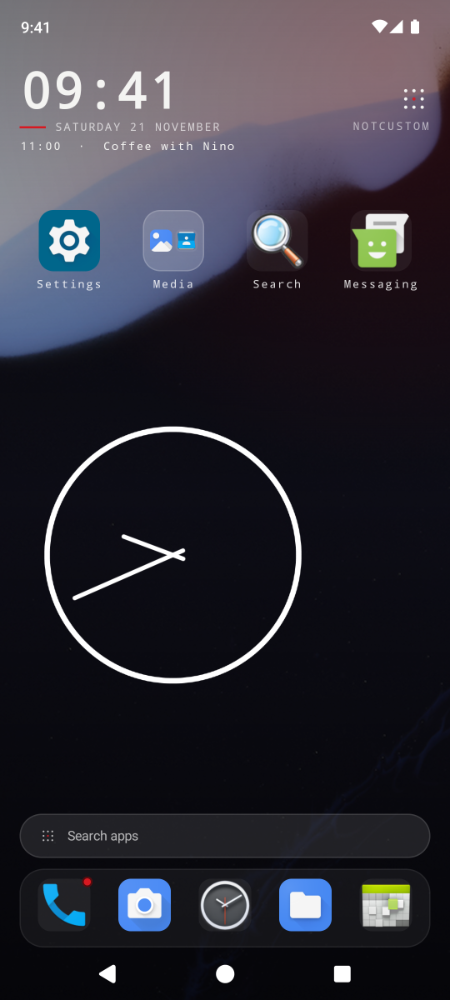
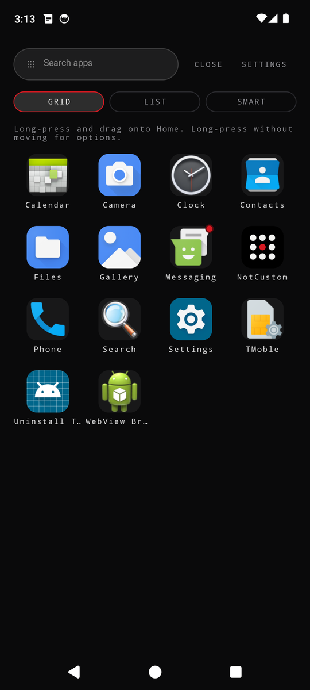
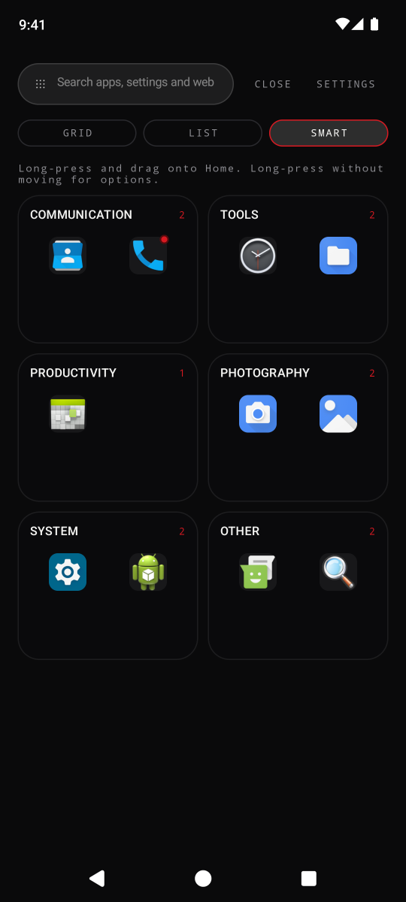
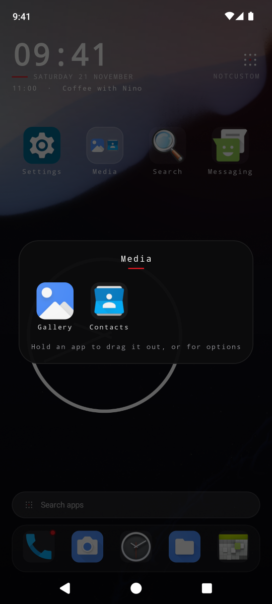
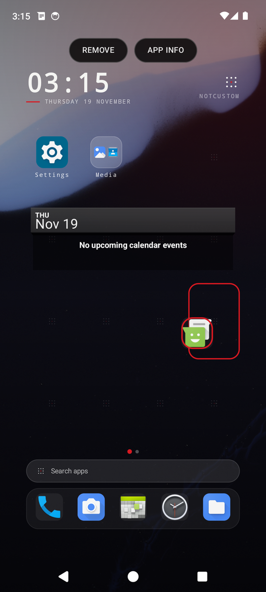
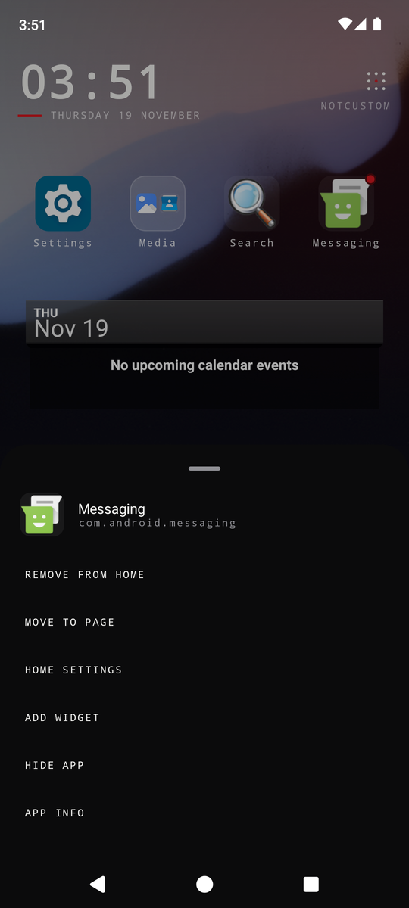
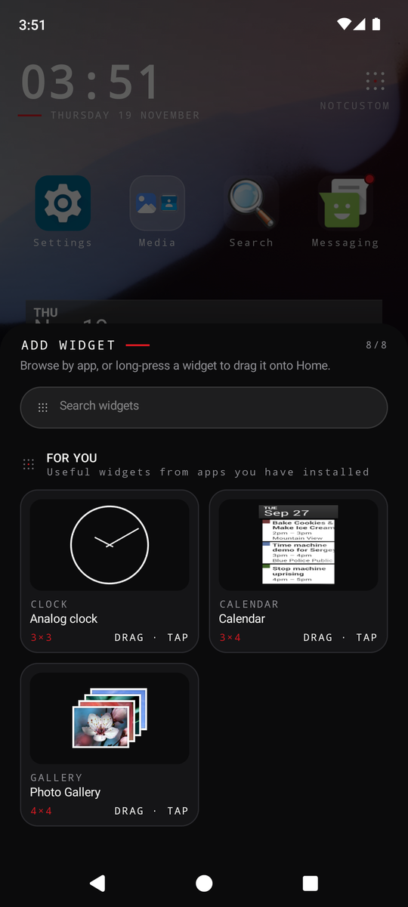
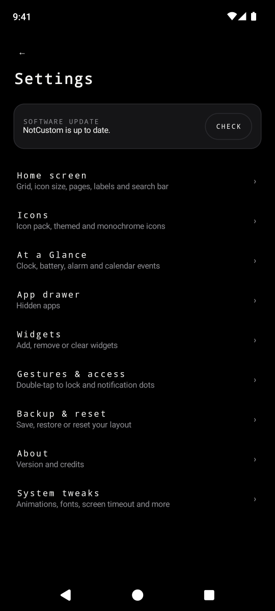
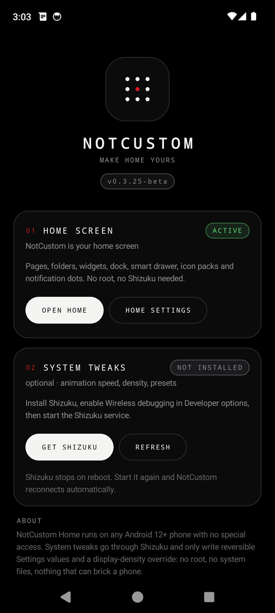

<p align="center">
  
</p>

<p align="center">
  <a href="https://github.com/ddddaaaattttoooo/notcustom/releases/tag/v0.3.27-beta"></a>
</p>

<p align="center">
  
  
  
  
  <a href="https://ko-fi.com/ddddaaaattttoooo"></a>
</p>

NotCustom is a monochrome Android launcher with pages, folders, widgets, a smart app drawer and notification dots, plus optional Shizuku-powered system tweaks. It takes visual cues from Nothing OS and leaves your phone's own launcher untouched.

> Not affiliated with Nothing Technology Limited. NotCustom needs no root and adds no Glyph features.

## Screenshots

<table>
  <tr>
    <td align="center"><br /><sub><b>Home</b></sub></td>
    <td align="center"><br /><sub><b>App drawer</b></sub></td>
    <td align="center"><br /><sub><b>SMART drawer</b></sub></td>
  </tr>
  <tr>
    <td align="center"><br /><sub><b>Folders</b></sub></td>
    <td align="center"><br /><sub><b>Drag and drop</b></sub></td>
    <td align="center"><br /><sub><b>App menu</b></sub></td>
  </tr>
  <tr>
    <td align="center"><br /><sub><b>Widgets</b></sub></td>
    <td align="center"><br /><sub><b>Home settings</b></sub></td>
    <td align="center"><br /><sub><b>Setup</b></sub></td>
  </tr>
</table>

## Features

**Home screen**
- Multiple pages, drag-and-drop placement, and a five-slot dock
- Folders: drop one app onto another, rename the folder, and drag apps back out
- Android widgets at their natural size, resizable from the corner handle
- Notification dots, app shortcuts, and pinned shortcuts from other apps
- Hold an app for its menu, or drag it onto REMOVE, UNINSTALL or APP INFO
- Clock, battery status or next alarm in the header, in 12 or 24-hour time

**App drawer**
- GRID, LIST and SMART modes; SMART groups apps into categories like Nothing OS
- Instant search, hidden apps, work-profile and cloned apps with badges
- Drag any app straight onto a Home page or the dock

**Look and feel**
- Columns, icon size, icon packs, monochrome icons, labels and search bar
- Gestures: swipe up for apps, swipe down for notifications, optional double-tap to lock

**Optional system tools** (through Shizuku, no root)
- Animation speed presets, display density and font scale, and a Quick Settings tile

## Install

1. Open the [release page](https://github.com/ddddaaaattttoooo/notcustom/releases/tag/v0.3.27-beta) on your phone and download `NotCustom-0.3.27-beta-release.apk`.
2. Open the file. If Android asks, allow your browser or Files app to install unknown apps, then tap **Install**.
3. Open NotCustom and tap **SET AS HOME**, or press Home and choose **NotCustom Home** → **Always**.
4. Optional: in Home Settings, turn on notification dots and gesture access. Sideloaded apps may need **App info → Allow restricted settings** first.

**Updating:** install the newer APK over the old one, or tap **CHECK** under Software update in Home Settings. Releases since 0.3.23 share one signing key, so updates install in place and keep your layout. Coming from an older build? Uninstall it once first.

## Compatibility

- **Android 12 or newer.** NotCustom uses standard launcher APIs and should work on any brand, including Nothing, Pixel and Samsung.
- **Tested on** a Nothing Phone (3a) Lite with Nothing OS 4.x and on the Android emulator. Gestures, widgets and launcher selection can vary by manufacturer.
- **System tweaks** need Shizuku and may not be supported on every Android build. The launcher works without them.

## Permissions and privacy

- **Internet** is used only to check for and download NotCustom updates from its GitHub and GitLab release pages. No analytics, tracking or background uploads.
- **Notification access** (optional) only counts which apps have notifications, for the dots. Notification content is never read or stored.
- **Accessibility** (optional) only performs actions you ask for, like opening notifications or locking the screen. It does not read the screen.
- **Shizuku** (optional) is used only for the system tweaks.
- Your layout, folders and settings stay on the phone.

## Build from source

Requirements: JDK 17 and Android SDK Platform 34.

```bash
git clone https://github.com/ddddaaaattttoooo/notcustom.git
cd notcustom
./gradlew assembleDebug
```

The APK is written to `app/build/outputs/apk/debug/`. Release builds use the shared beta key in `keystore/`; use your own key before distributing a fork.

## Help and contributions

Found a bug? Open an [issue](https://github.com/ddddaaaattttoooo/notcustom/issues) with your phone model, Android version, NotCustom version and steps to reproduce. Please leave out private logs and personal data.

Contributions are welcome. See [CONTRIBUTING.md](CONTRIBUTING.md) for the build and review workflow.

## Support

NotCustom is free and has no ads or tracking. If it is useful to you, you can support development on [Ko-fi](https://ko-fi.com/ddddaaaattttoooo).

## License

NotCustom is released under the [MIT License](LICENSE).
